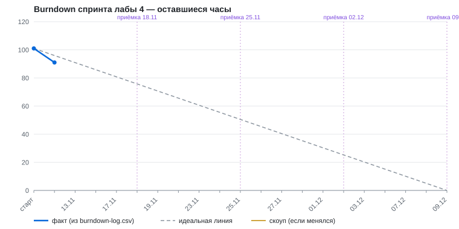

# Burndown спринта лабы 4

**Роль:** Product / VO
**Статус:** ведётся; спринт 12.11.2026 – 09.12.2026, Demo Day 10.12.2026
**Обновлено:** 2026-11-12

Четыре недели без графика темпа — четыре недели самообмана. График ниже строится из двух файлов и обновляется на каждом синхроне, а не рисуется в конце спринта.

---

## 1. Как устроено

| Что | Где | Кто меняет |
|---|---|---|
| Бэклог спринта: задачи, оценки, остаток, статус | [`docs/sprint/tasks.csv`](sprint/tasks.csv) | владелец задачи |
| Лог остатка по дням (только дополняется) | [`docs/sprint/burndown-log.csv`](sprint/burndown-log.csv) | скрипт |
| График | [`docs/sprint/burndown.svg`](sprint/burndown.svg) | скрипт |
| Скрипт | [`scripts/burndown.mjs`](../scripts/burndown.mjs) | — |

**Единица** — человеко-часы. Сторипоинты не используем: оценки в `docs/iteration-notes.md` уже даны в часах, и темп в часах сразу сравним с ёмкостью команды.

**Ёмкость:** 4 роли × ~25 ч за спринт ≈ 100 ч. Скоуп на старте — 101 ч, то есть спринт заполнен до предела, запаса нет. Поэтому правила резки скоупа записаны заранее (`docs/mvp-scope.md` §4).

**Разбиение:** ни одна задача не больше 6 ч. Задача крупнее разбивается до начала работы — иначе она неделю висит «в работе» и график стоит.

**Обновление (короткий синхрон пн / ср / пт, 10 минут):**

1. Каждый владелец правит свою строку в `tasks.csv`: `remaining_h` — сколько осталось по честной оценке сейчас; `status` — `todo` / `doing` / `done` / `cut`; `done_on` — дата закрытия.
2. Product запускает:
   ```bash
   node scripts/burndown.mjs record --note "что произошло"
   ```
   Скрипт считает остаток, дописывает строку за сегодня в лог и перерисовывает график и таблицы ниже.
3. Коммит `chore(burndown): DD.MM` — по истории коммитов видно, что точки ставились в свой день.

**Защита от рисования задним числом:** скрипт отказывается писать дату раньше последней записи в логе. Переоценка задачи меняет только будущие точки; прошлые строки лога не пересчитываются.

**Готово (`done`)** = принято на еженедельной приёмке по DoD (`docs/acceptance.md`), а не «код написан». Задача, не прошедшая приёмку, возвращается в `doing` с остатком по оценке владельца.

---

## 2. График



<!-- summary:start -->
| Показатель | Значение |
|---|---|
| Последняя запись | 12.11 (рабочий день 1 из 20) |
| Скоуп | 101 ч (на старте 101 ч) |
| Осталось | 91 ч |
| По идеальной линии | 95.9 ч |
| Отклонение | -4.9 ч (опережаем) |
| Фактический темп | 10 ч / рабочий день |
| Нужный темп до конца | 4.8 ч / рабочий день |
<!-- summary:end -->

Опережение первого дня — не темп команды: в этот день закрыты задачи планирования Product (P-01…P-05). Темп разработки станет виден после приёмки 18.11.

---

## 3. Отклонение от линии — повод для решения, не для паники

| Отклонение на приёмке | Что решаем |
|---|---|
| В пределах ±5 ч | Ничего не меняем |
| Выше линии на 5–15 ч | Смотрим, чья оценка «соврала»: переоцениваем задачу, перекидываем помощь между ролями |
| Выше линии больше чем на 15 ч | Режем скоуп по порядку из `docs/mvp-scope.md` §4 (сначала S9, затем письмо в S6). Вырезанная задача получает `cut`, решение — строку в `docs/acceptance.md` |
| Скоуп вырос (жёлтая линия) | Добавление без компенсации запрещено: взамен вырезается задача не меньшей оценки |
| Ниже линии больше чем на 10 ч | Проверяем, не закрыты ли задачи без приёмки по DoD |

Burndown не врёт — врут оценки. Поэтому при каждом отклонении сначала пересматривается оценка, а не люди.

---

## 4. Бэклог спринта

Колонка «Скоуп» — пункт из `docs/mvp-scope.md` §2. Оценки дал Product по `docs/iteration-notes.md` §3; владельцы ролей подтверждают или переоценивают их на синхроне 13.11.

<!-- tasks:start -->
| ID | Задача | Роль | Скоуп | Оценка, ч | Осталось, ч | Статус | Закрыта |
|---|---|---|---|---:|---:|---|---|
| P-01 | Бэклог спринта: оценка и разбиение задач, burndown | Product | — | 3 | 0 | ☑ done | 12.11 |
| P-02 | Фиксация MVP-скоупа к Demo Day | Product | — | 2 | 0 | ☑ done | 12.11 |
| P-03 | Приёмка 0: вход спринта (инкремент лабы 3 по DoD) | Product | — | 1 | 0 | ☑ done | 12.11 |
| P-04 | Исправить замечания лабы 3 (UC, validation-run, ссылки, дубль PRD) | Product | — | 1 | 0 | ☑ done | 12.11 |
| P-05 | Требования v3: PRD и UC по итогам месяца | Product | — | 3 | 0 | ☑ done | 12.11 |
| P-06 | Приёмка недели 1 (18.11) | Product | — | 1 | 1 | ☐ todo |  |
| P-07 | Приёмка недели 2 (25.11) | Product | — | 1 | 1 | ☐ todo |  |
| P-08 | Приёмка недели 3 (02.12) и решение по резке скоупа | Product | — | 1 | 1 | ☐ todo |  |
| P-09 | Приёмка недели 4 (09.12) и сценарий Demo Day | Product | — | 2 | 2 | ☐ todo |  |
| P-10 | Human review 18 черновиков (M4/M5) | Product+Quality | S5 | 2 | 2 | ☐ todo |  |
| A-01 | Единый контракт извлечения и ADR | AI | S4 | 2 | 2 | ☐ todo |  |
| A-02 | Адаптер frontend/lib/api.ts к AI API | AI+Delivery | S4 | 4 | 4 | ☐ todo |  |
| A-03 | Календарный resolver: reference_date, timezone, относительные дни | AI | S11 | 6 | 6 | ☐ todo |  |
| A-04 | Место: полное название и адрес, «как обычно» → null | AI | S2 | 3 | 3 | ☐ todo |  |
| A-05 | Цена: «бесплатно» = 0, тарифы парами | AI | S2 | 2 | 2 | ☐ todo |  |
| A-06 | Защита от инъекций: данные отдельно от инструкций | AI | S12 | 4 | 4 | ☐ todo |  |
| D-01 | Форма: поле даты, без даты сборка недоступна | Delivery | S1 | 2 | 2 | ☐ todo |  |
| D-02 | Карточка подтверждения критичных полей | Delivery | S2,S3 | 5 | 5 | ☐ todo |  |
| D-03 | Страница читает событие из БД по ID | Delivery | S7 | 4 | 4 | ☐ todo |  |
| D-04 | Регистрация: сохранение, ID, идемпотентность | Delivery | S8 | 5 | 5 | ☐ todo |  |
| D-05 | Список заявок в кабинете эксперта | Delivery | S9 | 3 | 3 | ☐ todo |  |
| D-06 | VK publisher в тестовое сообщество и статусы каналов | Delivery | S6 | 6 | 6 | ☐ todo |  |
| D-07 | Mailer через тестовый SMTP и письмо-уведомление | Delivery | S6,S10 | 4 | 4 | ☐ todo |  |
| D-08 | Версии события и API изменения времени/места | Delivery | S10 | 4 | 4 | ☐ todo |  |
| D-09 | UI правки: diff по каналам и итоговый статус | Delivery | S10 | 4 | 4 | ☐ todo |  |
| D-10 | CI/CD: автодеплой на сервер | Delivery | S13 | 6 | 6 | ☐ todo |  |
| D-11 | Мониторинг: health, latency, ошибки, алерт | Delivery | S13 | 5 | 5 | ☐ todo |  |
| Q-01 | Regression suite: даты, место, цена в CI | Quality | S13 | 4 | 4 | ☐ todo |  |
| Q-02 | Adversarial-набор: расширить, S1 ≥ 90% | Quality | S12 | 4 | 4 | ☐ todo |  |
| Q-03 | Сравнительный прогон и новый порог M2 | Quality | S4 | 3 | 3 | ☐ todo |  |
| Q-04 | E2E smoke UC-01/02/04 на стенде | Quality | S10 | 4 | 4 | ☐ todo |  |
<!-- tasks:end -->

Итого по ролям на старте: Product 17 ч, AI 21 ч, Delivery 48 ч, Quality 15 ч. Delivery перегружен почти вдвое относительно остальных — это главный риск темпа. Решение приёмки 0: A-02 делает AI вместе с Delivery, Quality берёт E2E (Q-04), Product — человеческую оценку черновиков (P-10).

---

## 5. Лог остатка

<!-- log:start -->
| Дата | Скоуп, ч | Осталось, ч | Комментарий |
|---|---:|---:|---|
| 12.11 | 101 | 91 | старт спринта: бэклог оценён, закрыты P-01…P-05 |
<!-- log:end -->

## Открытые вопросы

- Подтверждение оценок владельцами ролей — синхрон 13.11. Если суммарная переоценка превысит ёмкость, первая резка делается сразу, а не на неделе 3.
