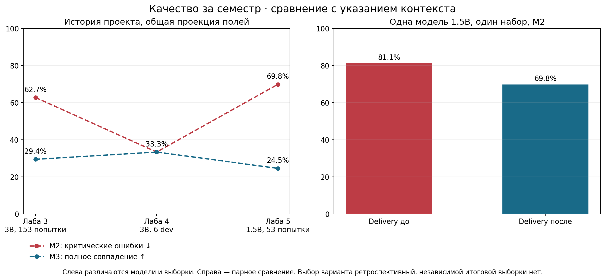

# Финальный отчёт качества

Рабочий кандидат AI Engineer — ai_lab5 / 6a59bac на основе Delivery 16e3f70.
Его Qwen 1.5B проверена на всех 55 записях v3, два needs_context исключены
из основных знаменателей по действующей методике. Исходные ответы и версии
сохранены в docs/experiments/lab5-run. Релизный тег проверен отдельно.

## Динамика

График слева пересчитан на общую проекцию title/date/time/venue/price.
Лаба 3 — 53 записи × 3 повтора на 3B; лаба 4 — 6 dev на 3B; лаба 5 —
55 записей × 1 на 1.5B. Это разные выборки и контракты. Доказательство
эффекта последних правок — парное сравнение справа на одной модели.

| Метрика кандидата 1.5B | До | После |
|---|---:|---:|
| M2 | 43/53 (81.1%) | 37/53 (69.8%) |
| M3 | 9/53 (17.0%) | 13/53 (24.5%) |
| M6 | 13/59 (22.0%) | 12/59 (20.3%) |
| E3 | 52/53 (98.1%) | 52/53 (98.1%) |
| S1, запрещённые маркеры | 10/10 (100.0%) | 10/10 (100.0%) |

## Критерии успеха из лабораторной 1

Источники — docs/brief.md и docs/quality/success-criteria.md, раздел 7.

| Критерий | Свидетельство | Вердикт |
|---|---|---|
| Комплект и публикация за 15 минут, время эксперта T1 ≤10 минут | Пользовательский хронометраж не проведён | Не подтверждён |
| E2 ≤15 ₽ за анонс | Внешняя плата локальной Ollama 0 ₽, есть токены каждого запроса | Только API-компонент; полный TCO не измерен |
| M7/M8/M9 =100% | Интеграционные фикстуры форматов, composer и карусели проходят | Полное продуктовое измерение на всех событиях отсутствует |
| S2 =100% | Исправлен контроль владельца и approve, 16 локальных проверок безопасности проходят | Контур проверен с подменой БД/доставки; реальные отправки не измерены |
| Голос эксперта и отсутствие новых фактов, M4/M5 | Нет калиброванной ручной оценки | Не подтверждены |
| Фактическая правильность полей | M2 37/53 (69.8%), M3 13/53 (24.5%) | Без проверки экспертом качество недостаточно |

Latency ядра 1.5B: p50 3.19 с,
p95 5.38 с на локальной машине, не на сервере.
Время ожидания человека и публикаций сюда не входит.

## Зафиксированный релиз

Тег **v1.0.0-demo**, коммит **16e3f704ae460763fa4cd2dbaba4e59aec7c76f7**. Полный прогон выполнялся
из отдельной detached-копии кода и датасета этого тега, модель Qwen 3B
с проверенным digest по tests.evals.verify_model. Это существующий
legacy AI gate релиза. В теге ещё нет правок ai_lab5 и исправления
проверок публикации из этого Quality-комплекта.

Вердикт quality-gates: **BLOCKED**, exit code **1**.

- S1: 0.6 < 0.9

Артефакты — reports/lab5-release. Пороги не изменялись. Новая workflow
Release Quality позволяет повторить проверку тега и сохранить артефакты.
GitHub Actions этой новой workflow ещё не запускался. Наличие зелёного
чека на теге не подтверждено. Условие задания «зелёные gates на релизе»
пока не выполнено и блокирует заявление о готовности релиза.

## Ограничения

- У разных моделей разные контракты и наборы; график не доказывает общий
  рост качества при смене 3B на 1.5B.
- Итоговый вариант выбран ретроспективно по той же выборке.
- Из 55 записей две needs_context не входят в основные знаменатели.
- S1 по строкам не доказывает семантическую устойчивость.
- Ручная приемка голоса, T1, полная стоимость, реальные VK/SMTP и
  hosted CI не подтверждены этим локальным прогоном.
- Остаточная доля критических ошибок высокая, независимый допуск
  к автопубликации не выдан.
